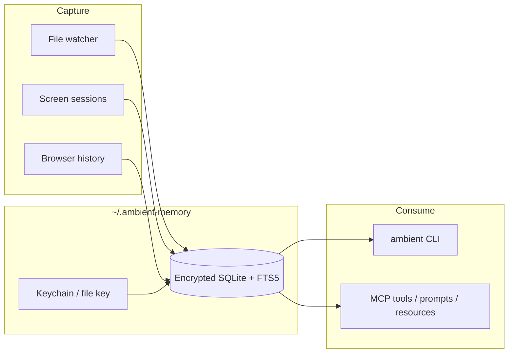

# ambient-memory

**Zero-config ambient memory for AI engineers** — a local-first context layer that passively remembers what you worked on and exposes it to Cursor / Claude Desktop over MCP.

No Markdown vault. No Git sync. No OAuth. Install in ~60 seconds and ask your agent *“what was I just doing?”*



## Why engineers install this

1. **MCP that agents actually use** — `memory_search`, `memory_recent`, `memory_get`, `memory_context`, `memory_relate`, `memory_status` with filters, pagination, typed errors, resources, and prompts.
2. **Retrieval that isn’t toy** — SQLite FTS5 + BM25, recency boost, path boost; eval fixtures for realistic queries.
3. **Privacy you’d ship** — keychain-first master key, AES-GCM field encryption, seal-on-stop vault, expanded secret redaction, integrity HMAC, no telemetry.
4. **Ingestion you can trust** — chokidar + debounce, ignore globs, secret file denies, size/binary/symlink guards, incremental `content_hash` reindex.
5. **DX that respects your time** — `ambient context --minutes 30`, `doctor`, dry-run, systemd/launchd examples, one-command tests.

## 60-second install

```bash
# from clone or unpacked release tarball
cd ambient-memory
npm install          # needs Node 20+; see Native deps if better-sqlite3 fails
npm test             # one command
npm run demo

node ./bin/ambient.js init
node ./bin/ambient.js start --screen auto    # headless: --screen simulated
node ./bin/ambient.js context --minutes 30
node ./bin/ambient.js search "auth middleware"
```

Until published to npm, use `node ./bin/ambient.js` or `./node_modules/.bin/ambient` from this directory.

## MCP setup (copy-paste)

### Cursor

Cursor → Settings → MCP:

```json
{
  "mcpServers": {
    "ambient-memory": {
      "command": "node",
      "args": ["/ABSOLUTE/PATH/TO/ambient-memory/bin/ambient.js", "mcp"]
    }
  }
}
```

### Claude Desktop

Edit `claude_desktop_config.json`:

```json
{
  "mcpServers": {
    "ambient-memory": {
      "command": "node",
      "args": ["/ABSOLUTE/PATH/TO/ambient-memory/bin/ambient.js", "mcp"]
    }
  }
}
```

**Tools:** `memory_search` · `memory_recent` · `memory_get` · `memory_context` · `memory_relate` · `memory_status`  
**Resources:** `ambient://status` · `ambient://recent` · `ambient://context`  
**Prompts:** `recall_recent_work` · `search_project_memory`

Ask: *“Use memory_context for the last 30 minutes and summarize what I was working on.”*

## Privacy & threat model

| Trust boundary | Assumption |
|----------------|------------|
| This machine’s user | Trusted — can read `~/.ambient-memory` if they own the account |
| Other local users | Blocked by `0700`/`0600` perms + optional OS keychain |
| Network / cloud | **No telemetry, no sync** in v0.2 |
| Indexed files | Content is redacted then encrypted at rest; FTS holds redacted plaintext for search |
| Compromised process with your UID | Can read the unlocked DB while the daemon/MCP runs (same as any local app) |
| At rest (daemon stopped) | Plaintext `memory.db` must be absent; only `memory.db.enc` (+ keychain/file key) |

**Controls:** OS keychain when available (macOS Keychain / Linux `secret-tool` / Windows CredMan best-effort) else `master.key` mode `0600`; AES-256-GCM fields; **seal to `memory.db.enc` on daemon stop and on CLI one-shots when the daemon is not running**; HMAC integrity meta; secret redaction (API keys, PATs, JWTs, PEM, connection strings, …); exclude paths + ignore globs; `ambient forget --all --yes`. See [SECURITY.md](./SECURITY.md).

Force file key: `--file-key` or `AMBIENT_FORCE_FILE_KEY=1`.

## Architecture (short)

- **Daemon** watches Documents/Desktop/Downloads/cwd (override with `--roots` / `--exclude`)
- **Store** SQLite WAL + encrypted entity fields + FTS5 index of redacted text
- **Screen** `xdotool` / `osascript` / `simulated` / `none` with session boundaries
- **Browser** optional Chrome/Firefox/Edge history; skips cleanly when locked/absent
- **CLI / MCP / library exports** share the same `MemoryStore`

## CLI

```bash
ambient init | start | stop | status | doctor
ambient search "query" [--type file,url] [--path-prefix /proj] [--since-mins 60] [-n 10]
ambient recent | context --minutes 30 [--json]
ambient forget "query" --yes | forget --all --yes
ambient mcp
ambient start --dry-run --screen simulated
```

## Native dependencies (`better-sqlite3`)

| OS | Need |
|----|------|
| macOS | Xcode CLT (`xcode-select --install`) |
| Linux | `build-essential` + `python3` |
| Windows | VS Build Tools (C++), **x64** Node |

## Development

```bash
npm install && npm test && npm run demo
npm run pack:release   # release/ambient-memory-0.2.0.{tar.gz,zip}
```

CI: `.github/workflows/ci.yml` (Ubuntu / macOS / Windows).

Optional units: `packaging/systemd/`, `packaging/launchd/`.

## Version

**0.2.1** — OR multi-term search, reliable seal-at-rest, honest doctor, clean `npm audit` (Zod override).

### Known limitations (honest)

- Screen/browser capture is best-effort (permissions / locked DBs / Windows → `simulated`/`none`)
- FTS keeps **redacted** plaintext for search; vault fields stay encrypted — see threat model
- Same-UID malware can read an unlocked vault while the daemon/MCP is running (normal for local apps)

## License

MIT
