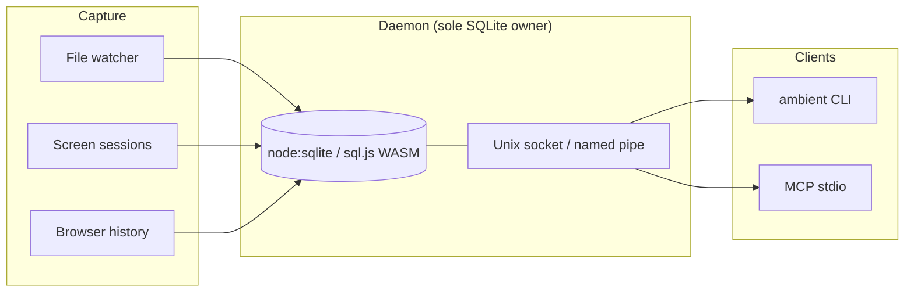

# ambient-memory

[](https://github.com/JarvisOsorio/ambient-memory/actions/workflows/ci.yml)
[](https://github.com/JarvisOsorio/ambient-memory/stargazers)
[](https://www.npmjs.com/package/ambient-memory)
[](./LICENSE)
[](https://nodejs.org)
[](https://modelcontextprotocol.io)

**⭐ [Star this repo](https://github.com/JarvisOsorio/ambient-memory)** if local agent memory without a Markdown vault sounds useful.

**Zero-config ambient memory for AI engineers** — a local-first context layer that passively remembers what you worked on and exposes it to Cursor / Claude Desktop over MCP.

Project page: [jarvisosorio.com/ambient-memory/](https://jarvisosorio.com/ambient-memory/) · Also by Jarvis: [mcp-pordego](https://github.com/JarvisOsorio/mcp-pordego) (MCP security scanner)

No Markdown vault. No Git sync. No OAuth. No native C++ / `node-gyp` install.



## Why v0.3

1. **True zero-config install** — `node:sqlite` on Node 22+, `sql.js` WASM fallback on Node 20. No `better-sqlite3`.
2. **Daemon-owned vault** — only the daemon opens/seals SQLite; CLI/MCP are IPC clients (no seal races).
3. **Honest crypto** — AES-GCM field encryption + sealed `.enc` at rest; FTS is redacted plaintext while unlocked (documented, not theater).
4. **Noise control** — ignore Slack/Spotify/etc., dedupe focus churn, session summarization for signal-heavy `memory_context`.
5. **npx-ready bins** — `ambient` and `ambient-memory` (use after npm publish).

## Install (from source — works now)

Requires **Node.js 20+** (22+ preferred for built-in SQLite).

`ambient-memory` is **not on the npm registry yet**. Install from GitHub:

```bash
git clone https://github.com/JarvisOsorio/ambient-memory.git
cd ambient-memory
npm install
npm test
node ./bin/ambient.js init
node ./bin/ambient.js start --screen auto    # headless: --screen simulated
node ./bin/ambient.js mcp
```

From the repo, use `node ./bin/ambient.js` anywhere you see `ambient-memory` below.

### After npm publish

Once [ambient-memory](https://www.npmjs.com/package/ambient-memory) is published (see [PUBLISH.md](./PUBLISH.md)):

```bash
npx -y ambient-memory init
npx -y ambient-memory start --screen auto
npx -y ambient-memory mcp
```

Do **not** rely on `npx -y ambient-memory` until `npm view ambient-memory version` succeeds.

### MCP — Cursor / Claude Desktop (from clone)

```json
{
  "mcpServers": {
    "ambient-memory": {
      "command": "node",
      "args": ["/ABS/PATH/ambient-memory/bin/ambient.js", "mcp"]
    }
  }
}
```

### MCP — after npm publish

```json
{
  "mcpServers": {
    "ambient-memory": {
      "command": "npx",
      "args": ["-y", "ambient-memory", "mcp"]
    }
  }
}
```

`mcp` auto-starts the daemon if needed. **Tools:** `memory_search` · `memory_recent` · `memory_get` · `memory_context` · `memory_relate` · `memory_status`

## CLI

```bash
ambient-memory init | start | stop | status | doctor
ambient-memory search "query" [--type file,url] [--since-mins 60]
ambient-memory recent | context --minutes 30 [--json]
ambient-memory forget "query" --yes | forget --all --yes
ambient-memory mcp
```

## Privacy & crypto (honest)

| Layer | Behavior |
|-------|----------|
| Entity fields | AES-256-GCM |
| At rest | `memory.db.enc` only when daemon stopped |
| FTS while unlocked | Redacted **plaintext** (search tradeoff) |
| Network | No telemetry / sync in v0.3 |
| Process model | Daemon owns DB; clients use IPC |

See [SECURITY.md](./SECURITY.md).

## Architecture

- **Daemon** watches Documents/Desktop/Downloads/cwd; indexes screen/browser with noise filters
- **Store** SQLite via `node:sqlite` or `sql.js`; FTS5/BM25; field encryption; seal-on-stop
- **IPC** Unix socket `~/.ambient-memory/ambient.sock` (Windows named pipe)
- **CLI / MCP** never open SQLite directly in normal operation

Force WASM backend: `AMBIENT_SQLITE_BACKEND=sql.js`. Force file key: `--file-key` / `AMBIENT_FORCE_FILE_KEY=1`.

## Related

- Project site: [jarvisosorio.com/ambient-memory/](https://jarvisosorio.com/ambient-memory/)
- [mcp-pordego](https://github.com/JarvisOsorio/mcp-pordego) — MCP security scanner by Jarvis Osorio ([site](https://jarvisosorio.com/mcp-pordego/))

## Development

```bash
npm install && npm test && npm run demo
```

## Version

**0.3.0** — breaking: no native SQLite addon; daemon-owned IPC; noise control; npx bins.

## License

MIT
